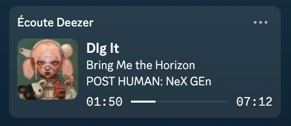

<div align="center">


# deezer-presence

**Show what you're listening to on Deezer in your Discord status.**

Spotify gets a native Discord integration. Deezer doesn't. This fixes that.

[](LICENSE)


[](https://github.com/BambouJumpOnYou/deezer-presence/actions/workflows/ci.yml)


</div>



## Features

- 🎧 **"Listening to Deezer"** status with title, artist, album cover and a live progress bar
- 🔗 **"Listen on Deezer"** button so your friends can open the track in one click
- 🌍 **Speaks your language.** English, French, Spanish, German, Italian and Portuguese, picked from your system settings
- 🪶 **Works with the official Deezer desktop app.** No modded client, no login, nothing touches your audio
- 🫥 **Stays out of the way.** A small waveform in your menu bar (or system tray on Windows) shows what's being shared
- 🚀 **Launch at login** with a single click from the menu
- ⏸️ **Goes quiet on pause**, just like Spotify does
- ⚙️ **Zero setup.** No Discord app to create and no token to paste. Run it and you're done

## Why another Deezer RPC?

Most existing Deezer Discord integrations ship their own wrapper around Deezer's web player. That works until it doesn't:
weird audio glitches, broken logins after a Deezer update, and so on.

deezer-presence takes the opposite approach and **only reads** what your system says is playing.
Your music stays in the official app. If this tool ever crashes, the worst case is that your Discord status disappears.

## Getting started

Grab the zip for your system from the [latest release](https://github.com/BambouJumpOnYou/deezer-presence/releases/latest).
You'll also need the Deezer and Discord desktop apps.

### macOS

Requires macOS 12 or later, on Apple Silicon or Intel.

1. Download `Deezer-Presence-<version>-macos.zip`, unzip it and drag **Deezer Presence** into your Applications folder.
2. Open it. The app isn't notarized by Apple yet, so macOS will block it the first time:
   go to **System Settings → Privacy & Security**, scroll down and click **Open Anyway**.
   <details><summary>Prefer the terminal?</summary>

   ```sh
   xattr -dr com.apple.quarantine "/Applications/Deezer Presence.app"
   ```

   </details>

### Windows (beta)

Requires Windows 10 or 11.

1. Download `Deezer-Presence-<version>-windows.zip` and unzip it wherever you like.
2. Run **Deezer Presence.exe**. The app isn't signed yet, so SmartScreen may warn you the first time:
   click **More info → Run anyway**.

The waveform shows up in the system tray (you may need to click the ^ arrow next to the clock).

### Using it

Play something on Deezer and your status should show up within a couple of seconds.
Click the waveform to see what's being shared, turn on **Launch at login**, or quit.

### Building from source

You'll need [Rust](https://rustup.rs), plus the Xcode Command Line Tools on macOS (`xcode-select --install`).
On Windows, `cargo build --release` is all it takes. On macOS:

```sh
git clone https://github.com/BambouJumpOnYou/deezer-presence.git
cd deezer-presence
./scripts/bundle-macos.sh              # builds dist/Deezer Presence.app
./scripts/bundle-macos.sh --universal  # same, for Apple Silicon and Intel
```

For quick iterations, skip the bundle with `cargo run --release`.

### Configuration

Everything works out of the box, but you can tweak a few things with environment variables:

| Variable | Description |
|---|---|
| `DISCORD_CLIENT_ID` | Use your own Discord application instead of the default one |
| `DEEZER_PRESENCE_LANG` | Force a language (`en`, `fr`, `es`, `de`, `it`, `pt`) instead of your system's |

## Translations

The menu bar and the Discord button follow your system language and fall back to English.
Want to see your language? All strings live in [`src/i18n.rs`](src/i18n.rs).
Add a block for your language, map its code in `for_locale`, and open a PR. That's it!

Note that the Discord button is shown in *your* language to everyone who views your profile.

## How it works

1. **Reading what's playing.**
   - On **macOS**, media info lives in the private MediaRemote framework, which Apple has restricted to its own
     binaries since macOS 15.4. A tiny helper ([`macos/helper.m`](macos/helper.m)) gets around this by running inside
     `/usr/bin/perl`, and asks MediaRemote for Deezer's player specifically rather than whatever plays last.
     That way a YouTube tab or a Twitch stream can't hide your music.
   - On **Windows**, it uses the official [media session API](https://learn.microsoft.com/uwp/api/windows.media.control)
     (the one behind the media controls in the volume flyout) and picks Deezer's session.
2. **Finding the cover.** The track is looked up through [Deezer's public search API](https://developers.deezer.com/api/search)
   to get the album art and a link to the track. Results are cached.
3. **Updating Discord.** The status is sent to your local Discord client over its IPC socket as a *Listening* activity.

## Known limitations

- **Not signed.** macOS Gatekeeper and Windows SmartScreen warn about the app the first time.
  See [Getting started](#getting-started).
- **Windows support is new.** If something looks off, please [open an issue](https://github.com/BambouJumpOnYou/deezer-presence/issues).
- **Relies on private macOS APIs.** If a macOS update changes them, the status will stop updating until
  deezer-presence is updated. Deezer itself will keep working normally.

## Roadmap

- [x] Windows support through the official media session API (GSMTC)
- [x] Launch at login
- [x] Prebuilt releases

## Acknowledgements

This project stands on the shoulders of some great open-source work:

- **[mediaremote-adapter](https://github.com/ungive/mediaremote-adapter)** by [@ungive](https://github.com/ungive),
  whose `/usr/bin/perl` trick is what makes reading media info possible on recent macOS. Go give it a ⭐
- **[discord-rich-presence](https://github.com/vionya/discord-rich-presence)** by [@vionya](https://github.com/vionya) (MIT), for talking to Discord over IPC
- **[tray-icon](https://github.com/tauri-apps/tray-icon)**, **[muda](https://github.com/tauri-apps/muda)** and **[tao](https://github.com/tauri-apps/tao)**
  by the [Tauri](https://tauri.app) team (MIT / Apache-2.0), for the menu bar icon and app event loop
- **[ureq](https://github.com/algesten/ureq)** (MIT / Apache-2.0) and **[serde](https://serde.rs)** (MIT / Apache-2.0), for HTTP and JSON
- **[sys-locale](https://github.com/1Password/sys-locale)** by 1Password (MIT / Apache-2.0), for detecting the system language
- **[windows-rs](https://github.com/microsoft/windows-rs)** by Microsoft (MIT / Apache-2.0), for the Windows media session API and registry
- **[winresource](https://github.com/BenjaminRi/winresource)** (MIT), for embedding the icon in the Windows executable
- The **[Deezer API](https://developers.deezer.com/api)** for covers and track links, and
  **[Discord Rich Presence](https://discord.com/developers/docs/rich-presence/overview)** for the status itself

## License

[MIT](LICENSE) © 2026 BambouJumpOnYou

Third-party dependencies keep their own licenses.

---

<sub>deezer-presence is a community project and is not affiliated with, endorsed by, or sponsored by Deezer or Discord.</sub>
